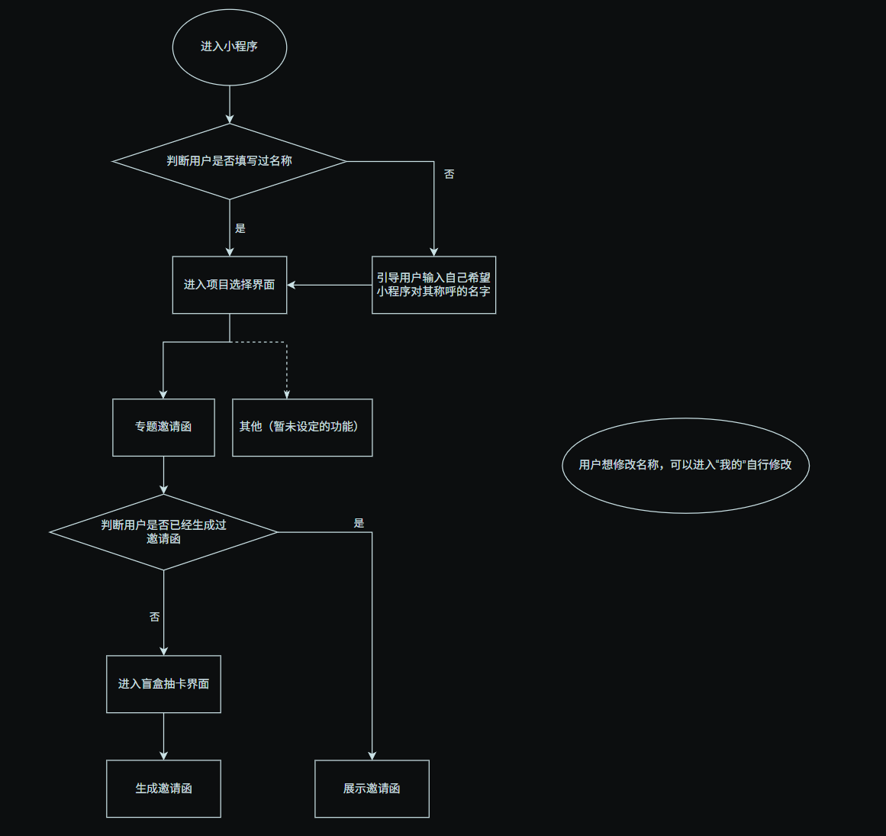
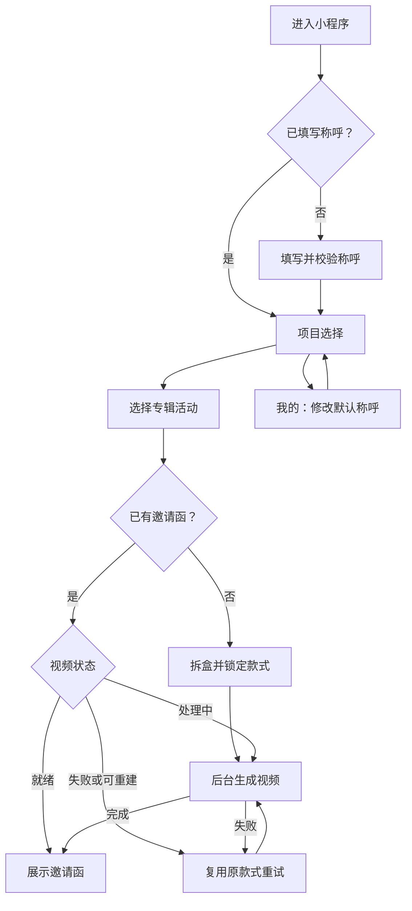

# 页面、流程与交互规格

## 1. 输入流程图

原图保留“填称呼→选项目→专题邀请函→首次抽卡／已有则展示”和“我的修改称呼”。本方案补充网络异常、渲染任务、分享访客与运营下架分支。

## 2. 普通用户主流程

活动未开始、结束、暂停与下架时，先应用活动权限；不会因本地缓存显示了“抽取”按钮而越过服务端检查。

## 3. 页面清单

底部导航只有「发现」「我的」。生成页和邀请函页为普通堆栈页面；分享访问页使用独立只读路由。

| 页面／建议路由 | 核心内容 | 主操作 | 状态与返回规则 |
| --- | --- | --- | --- |
| 启动分流 `pages/entry/index` | 品牌过渡、恢复会话 | 自动分流 | 登录失败可重试；分享入口先去只读页 |
| 称呼 `pages/onboarding/name` | 品牌标识、称呼输入、规则说明、隐私入口 | “就这样称呼我” | 校验／审核错误留在本页；提交中禁连点 |
| 发现 `pages/discover/index` | 当前称呼、专辑活动卡片、状态／日期 | “打开专辑邀请” | 空列表给明确说明；不展示“其他未定功能”假入口 |
| 活动 `pages/campaign/index?id=…` | 封面、发行信息、玩法、保存期、款式说明 | “抽取我的邀请”或“查看我的邀请” | 已抽取显示结果入口；未开始显示日期 |
| 拆盒 `pages/draw/index?id=…` | 信封／唱片袋、轻量动效、请求状态 | “拆开邀请” | 网络未确认时不揭晓；1.5–2 秒动效可减少 |
| 生成 `pages/generation/index?id=…` | 已抽款式、处理阶段、说明 | “稍后在我的查看”／失败时“重试” | 阶段为排队、合成、上传、完成；没有虚构百分比 |
| 邀请函 `pages/invitation/index?id=…` | 9:16 成片、称呼、曲目和背景名 | 播放、保存、分享 | 新版本生成时旧版本仍可看；过期给重建入口 |
| 我的 `pages/me/index` | 当前称呼、作品列表、隐私和删除入口 | 改称呼／打开作品 | 空作品引导去发现；删除动作二次确认 |
| 分享访问 `pages/share/index?t=…` | 朋友已公开的邀请函、专辑信息 | “制作我的邀请函” | 失效令牌显示通用活动入口，不显示旧姓名 |

## 4. 四个关键页面的布局

| 页面 | 从上到下的内容 | 设计约束 |
| --- | --- | --- |
| 称呼页 | 乐队标识 → “这封邀请，该写给谁？” → 输入框 → 字数提示 → 主按钮 → 隐私说明 | 键盘弹起后按钮可见；错误靠近输入框 |
| 活动页 | 专辑主视觉 → 乐队／专辑名 → 玩法一句话 → 款式预告 → 抽取按钮 → 活动规则 | 不抢先播放有声音乐；隐藏内容用轮廓或局部预告 |
| 拆盒页 | 信封主体 → 点击提示 → 状态说明 → 返回入口 | 点击目标足够大；减少动态模式下用渐显代替大幅动画 |
| 邀请函页 | 顶部返回 → 视频区域 → “诚邀 XXX 收听” → 曲目名 → 保存／分享 → 收听完整专辑入口 | 视频中文字与网页文案一致；导出结果不依赖页面覆盖层 |

视觉默认采用“专辑封面延伸＋信封／唱片封套”语言。每个活动只配置主色、背景、标识和有限布局，不首期开发任意拖拽编辑器。颜色、字体和氛围由真实专辑素材决定，不使用未授权视觉或虚构乐队品牌。

## 5. 生成体验

抽取请求完成后可立即展示静态预览，明确标为“预览”；若提供母版试听，称呼在页面上叠加但不可标成已导出视频。最终 MP4 就绪后才开放“保存视频”和个性化分享。

轮询建议 2 秒起，逐步到 5 秒并加随机抖动；页面隐藏时暂停，回来立即查询。超过 60 秒改为“还在制作，可以稍后回来查看”，任务仍继续。首次请求丢失时先查询当前邀请函，不触发重新抽取。

本期不把订阅消息作为完成通知依赖；“我的”可找回。对低性能设备提供轻动画模式；返回和关闭播放时停止媒体，防止两段音乐叠加。

## 6. 保存与分享操作

| 操作 | 步骤 | 失败处理 |
| --- | --- | --- |
| 保存视频 | 获取有效下载地址 → 下载至临时路径 → 用户触发相册保存 | 地址失效则刷新一次；权限拒绝给设置说明；不循环弹授权 |
| 分享邀请 | 已生成成片 → 明确开启分享 → 准备随机令牌 → 用户点击微信分享按钮 | 链接未准备好时不开放按钮；允许随时关闭 |
| 分享访问 | 令牌换取只读展示信息 → 点击播放 → 可转向本人制作 | 令牌失效／下架／删除时返回通用说明 |
| 更新称呼 | “我的”保存新称呼 → 原邀请函选择“用新名字更新” → 显示前后文案 → 合成 | 原成功版本保留，生成完成后撤销旧分享并要求重新开启 |

微信 `onShareAppMessage`、视频相册保存与隐私授权需按当前官方接口和真机结果适配。本次未能读取微信开发者站点正文，接口入口与必须验证的项目列在 [依据与待确认事项](07-evidence-decisions.md)，不据此承诺所有微信版本和平台行为完全一致。

## 7. 可直接采用的状态文案

| 场景 | 文案 |
| --- | --- |
| 没有称呼 | “留一个你喜欢的称呼，我们把邀请写给你。” |
| 不支持的字符 | “这个称呼暂时无法完整显示，试试中文、英文或数字。” |
| 名称过长 | “邀请函里放不下这个称呼，试试更短一点。” |
| 审核未通过 | “这个称呼暂时无法使用，请换一个。” |
| 排队 | “已为你抽到专属款式，正在制作邀请函。” |
| 等待较久 | “制作还需要一点时间，你可以稍后在「我的」查看。” |
| 可重试失败 | “这次制作没有完成，你抽到的款式已保留。” |
| 保存权限被拒绝 | “需要允许保存到相册，才能带走这段视频。你也可以继续在这里收听。” |
| 改名提示 | “这会更新你的默认称呼。已有邀请函可单独更新，音乐和背景保持原款式。” |
| 失效分享 | “这封邀请暂时无法查看。可以去看看专辑活动。” |

## 8. 设计交付要求

1. 提供以上页面的常态、加载、空态、失败和禁用状态，标注可点击区域与键盘避让。
2. 提供 720×1280 成片模板与 1080×1920 设计源稿，标注姓名安全区域、字号下限和长名字样例。
3. 提供拆盒动效及无动效版本，标注时长和触发事件；动效不得决定随机结果。
4. 提供通用分享封面和邀请函封面；无同意时分享卡片不含个人称呼。
5. 用短中文、16 字长名、英文长名、繁体和生僻字样本检查可读性；字体缺字时在生成前反馈。
