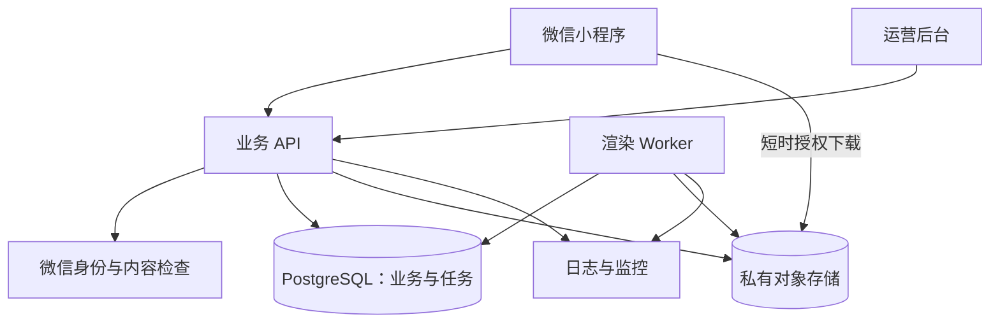
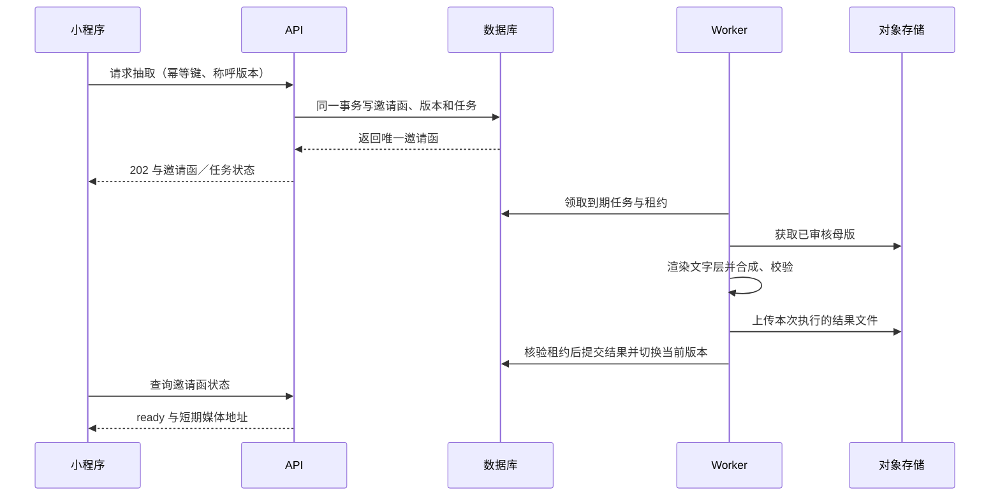

# 技术架构与实现方案

## 1. 技术选型

| 层 | 推荐 | 选择理由／边界 |
| --- | --- | --- |
| 用户端 | 微信原生小程序＋TypeScript＋WXML／WXSS | 只做微信首版，直接使用播放、分享与相册能力 |
| 管理端 | Vue 3＋Vite＋TypeScript | 素材表单、预览和任务看板；不在用户端暴露管理能力 |
| 业务 API | Node.js 受维护 LTS＋Fastify＋TypeScript | 统一接口模型与参数校验；版本在开工时锁定 |
| 数据库 | 托管 PostgreSQL | 用户／活动唯一约束、事务、版本和任务持久化 |
| 任务执行 | 独立 Docker Worker＋FFmpeg＋字体渲染库 | 与 API 隔离 CPU／内存，支持真实视频输出 |
| 文件与分发 | 腾讯云 COS 私有桶；静态公共物料可加 CDN | 原始素材与个性化视频分开权限与生命周期 |
| 初期部署 | API 与 Worker 分开容器部署于云服务器；数据库托管 | Worker 常驻拉取任务，不依赖 HTTP 长连接或缩容到零的后台进程 |
| 运行保障 | 结构化日志、错误监控、资源／队列告警、自动备份 | 建立可定位、可重试、可回滚的运行闭环 |

不要求 GPU，不以大模型生成音视频。云函数／云托管可以作为替代部署方案，但需确认 FFmpeg 运行依赖、执行时限、临时磁盘、任务触发及最小实例策略；不可把长时间合成放在一次普通小程序请求里等待。

## 2. 系统边界

`API → OBJ` 用于签发受限地址、校验上传和删除任务；MP 不能列桶或拿长期存储凭据。部署图表示读写关系，任务分配具体机制如下。

## 3. 身份与首次进入

普通入口先展示必要的信息处理说明；建立个人业务记录前走适用的用户同意流程。调用 `wx.login` 获取一次性 code，API 与微信服务端交换身份；以 `(appid, openid)` 唯一确定本项目用户，签发自有短期会话。AppSecret、session_key 和存储密钥只在服务端。

客户端不提交可信的 `user_id` 或 `openid`，后端从会话派生。OpenID 不放日志、分享链接、对象路径或统计事件。加密保存原值，使用服务端 HMAC 摘要建立唯一索引。会话有效期固定 2 小时，到期重新进行微信登录换取会话；后端只存令牌哈希，注销／删除立即撤销。

本地只缓存必要的称呼和最近作品摘要。冷启动、切换帐号或恢复前台时以服务端为准；缓存键按内部用户区分，退出清除。分享访客可先通过能力令牌只读访问，不为查看朋友邀请强制申请个人称呼。

## 4. 抽取与持久任务

数据库中的 `render_jobs` 是首版持久任务队列。创建邀请函与创建任务在一个事务内，不采用“先写数据库、再尝试发送消息”的非原子做法。

Worker 用短事务 `SELECT … FOR UPDATE SKIP LOCKED` 领取到期任务，更新 `lease_owner`、递增 `lease_epoch` 并写入到期时间后立即提交；渲染期间不持有数据库行锁。每 15 秒续租，初始租约 60 秒；单次执行建议硬超时 120 秒，须根据真实模板调整。

完成与失败写回必须匹配任务 id、generation、租约 epoch、有效租约和有效状态；旧 Worker 租约失效后即使完成，也不能覆盖新结果。每次执行上传到含 epoch 的临时对象路径，只有成功写回的对象成为正式引用，孤立对象由清理任务回收。上传成功但数据库写回失败时，重试先核对已存在对象与校验结果，避免盲目重复消费。

默认每个生成周期首次加两次自动重试，使用 5 秒、30 秒退避与抖动；超时、临时网络失败可重试，文件损坏、缺字体、授权失效等永久错误直接失败并通知运营。用户手动重试最多提前唤醒预算内的待重试任务，不能重置次数；预算耗尽后只有运营排障批准或合法过期重建才能开始新周期。`generation` 记录周期，`attempts` 记录周期内次数，所有周期的执行结果进入审计。定时扫描回收过期租约，不能让任务永久停在 running。

## 5. 视频合成链路

| 阶段 | 输入／处理 | 输出与检查 |
| --- | --- | --- |
| 素材入库 | 运营上传音频、背景、固定视觉；校验 MIME、真实编码、时长与使用期限 | 仅合格资产进入可发布状态 |
| 母版预制 | 每个批准组合制作背景＋副歌＋固定视觉 | 统一 720×1280、30fps、H.264／AAC 的母版，音画节奏由设计确认 |
| 文本排版 | 称呼通过审核后，用固定授权字体生成透明文字 PNG | 测量宽度、换行、字号下限、缺字校验 |
| 个性化合成 | FFmpeg overlay 母版与文字 PNG | 姓名真正烧录到 MP4；不是只在页面叠字 |
| 成片校验 | ffprobe 检查视频／音轨、时长、分辨率、编码、文件尺寸；解码首尾样本帧 | 非零文件不等于成功；满足媒体标准才允许 ready |
| 发布结果 | 上传私有桶、生成封面，事务写回 | 最终下载视频可离开小程序独立播放 |

固定首版输出参数（详见docs/16）：9:16、720×1280、30fps、H.264、`yuv420p`、AAC-LC 128 kbps、视频目标 2 Mbps、`faststart`；时长按模板 15–30 秒，20 秒为估算基准。素材长短、淡入淡出、裁切与字幕安全区由模板固定，不由用户随意输入。

母版已包含音轨时，合成时可复制兼容音轨；如果音轨规格不合适则按统一参数编码。滤镜和流映射从已验证模板生成，固定选择母版音频。透明 PNG 仅作为视频叠加输入，不能用其单帧时长误截断整段视频。构建镜像固定 FFmpeg 功能、字体文件及版本，并记录渲染配置摘要。

对中文采用成熟的文字塑形／绘制库生成 PNG；字体路径和渲染参数只由服务端模板指定。用进程参数数组启动 FFmpeg，禁止拼接用户字符串为 shell 命令。首版不采用 drawtext 替代路线；具体排版/子进程/校验步骤见 [视频实施手册](16-media-implementation.md)。

## 6. 并发、版本与缓存

| 风险 | 处理 |
| --- | --- |
| 同一用户多个设备同时抽取 | 数据库唯一索引兜底；冲突时读回原记录，未提交的随机结果不对外展示 |
| 配置在抽取瞬间更换 | 事务锁定活动当前发布版本并保存快照；只抽该版本内可用组合 |
| 改名与抽取同时发生 | 请求携带 `expectedNameVersion`；事务对用户版本作检查，冲突返回 409 |
| 两个改名合成并发 | 每邀请函最多一个非终态待生成版本；返回现有任务或冲突，避免旧任务覆盖较新名字 |
| 媒体过期与重建 | 先确认活动保留期和权利有效，复用原版本；可用缓存以版本哈希为键 |
| 用户删除／活动撤回与完成竞态 | Worker 提交前再次检查取消标记、用户和活动可用性；不重新暴露已删除数据 |

母版可以跨用户共享；个性化文件以用户邀请函和版本隔离，即使两人同名也不默认共用成片，避免删除、追踪和访问权限混淆。

## 7. 分享与文件权限

原始素材、未发布模板与个性化视频均私有；客户端只能获得用途限定、短期有效的读取地址。签名有效期最长 5 分钟，需要时重新获取。视频开始或下载期间确保剩余时长足够，过期仅自动刷新一次，避免失败循环。

分享令牌为至少 128 位不可预测值，绑定指定邀请函版本和失效时间。为兼容创建接口的幂等重放，使用服务端独立密钥对随机分享记录 id 作 HMAC-SHA-256 派生，数据库存令牌哈希和密钥版本，重放时重新派生同一个令牌；密钥不传客户端。它是“持链接可看”的权限凭证，不是公开可枚举的用户 ID。默认 30 天有效，且不能超过活动保留期／素材授权期。创建需要所有者明确开启，关闭后 API 立即拒绝新访问。

已签发的地址在失效前仍可能可用，因此关闭／删除不能声称瞬间收回所有外部副本；上限是签名有效窗口。敏感撤回执行对象移除与 CDN 清理，仍不保证收回已经被用户下载的文件。私有签名路径如接 CDN，必须验证边缘鉴权；不得因忽略鉴权查询参数而变成公开缓存。

## 8. 部署、环境和目录规划

本节是**待实现的结构**，不是当前已存在或可运行的工程。

| 路径 | 后续内容 |
| --- | --- |
| `apps/miniprogram/` | 原生小程序源码、`app.json`、`project.config.json`、页面与组件 |
| `apps/admin/` | 管理后台与权限界面 |
| `services/api/` | 身份、活动、抽取、分享、运营接口 |
| `services/render-worker/` | 母版预处理、文字层、FFmpeg、任务领取与重试 |
| `packages/contracts/` | 请求、响应、错误码与配置 schema |
| `db/migrations/` | PostgreSQL 可版本化迁移 |
| `infra/` | 本地 Compose、容器构建、部署与回滚脚本 |
| `tests/` | 并发／幂等、权限、媒体和端到端验证 |

`dev / staging / prod` 分离 AppID 配置、数据库、桶、域名与会话密钥；环境密钥由部署平台注入，`.env.example` 仅写字段名和占位值。最低配置项包括 WX_APP_ID、WX_APP_SECRET、DATABASE_URL、OPENID_ENCRYPTION_KEY_VERSION及版本密钥、OPENID_HMAC_KEY、SHARE_HMAC_KEY_VERSION及版本密钥、ADMIN_CSRF_KEY_VERSION及版本密钥、ADMIN_TOTP_ENCRYPTION_KEY、COS_REGION、COS_BUCKET、COS_ACCESS_ROLE、PUBLIC_API_ORIGIN、ADMIN_ORIGIN、RENDER_CONCURRENCY。工作负载优先使用临时角色凭证。

正式环境 API 与 Worker 分开资源配额；API 至少保留一个可服务实例，Worker 根据最老任务等待时间和 CPU 扩容。数据库仅内网连接、每日备份，操作日志去敏；对象存储生命周期和清理任务均启用。初期单机容器方案存在主机故障风险，流量发布前按业务要求决定是否升级多实例。

实现后的本地运行文档应逐项提供：安装锁定依赖、填写开发环境、启动依赖容器、运行迁移、启动 API／Worker／管理端、导入 `apps/miniprogram` 文件夹、选择对应 AppID、真机预览。微信开发者工具导入的是**完整项目文件夹**；不能只导入 PNG、视频或方案 Markdown。

## 9. 监控与降级

| 信号 | 初始告警阈值／动作（上线前调参） |
| --- | --- |
| 渲染失败率 | 15 分钟样本 ≥20 且失败 >5%：排查母版、字体、存储和资源 |
| 最老排队任务 | >120 秒：告警；>300 秒暂停新增抽取，已抽结果保留 |
| API 错误 | 5 分钟 5xx >1% 且样本 ≥100：检查依赖与发布 |
| 成本异常 | 日预算 50%／80%／100% 分级提示；达到上限按运营配置暂停新增生成 |
| 资源／对象异常 | 临时磁盘 >80%、数据库连接接近上限、COS 鉴权错误：分别处理，不无差别重试 |

降级优先保留已有成片播放，暂停新增抽取；未生成的静态预览仍标为预览。HTTP 健康检查区分 `/health/live`（进程存活）与 `/health/ready`（必要依赖可用），端点由本项目实现，不假设平台自动提供。
